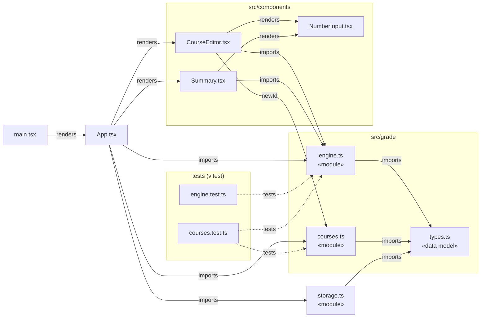
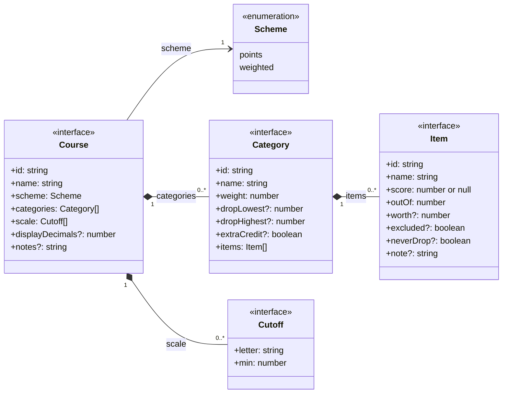
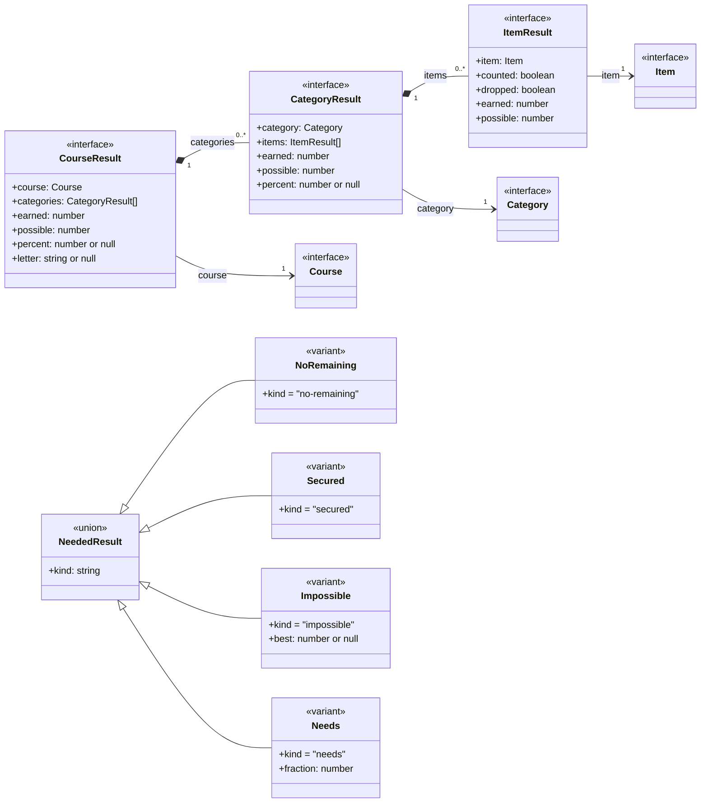
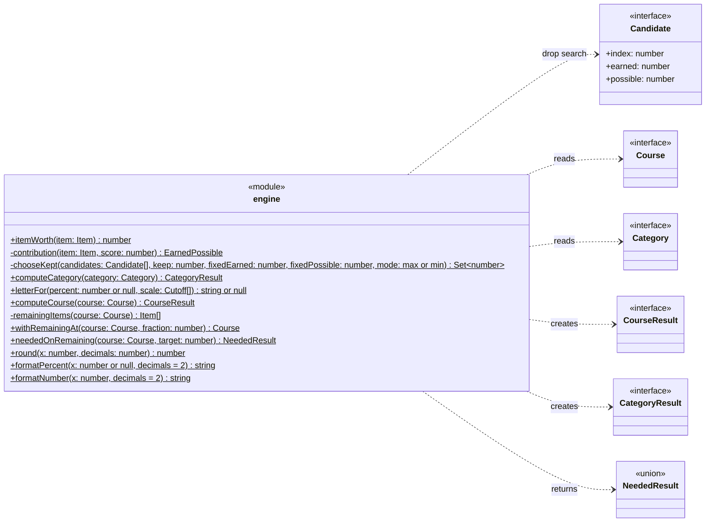
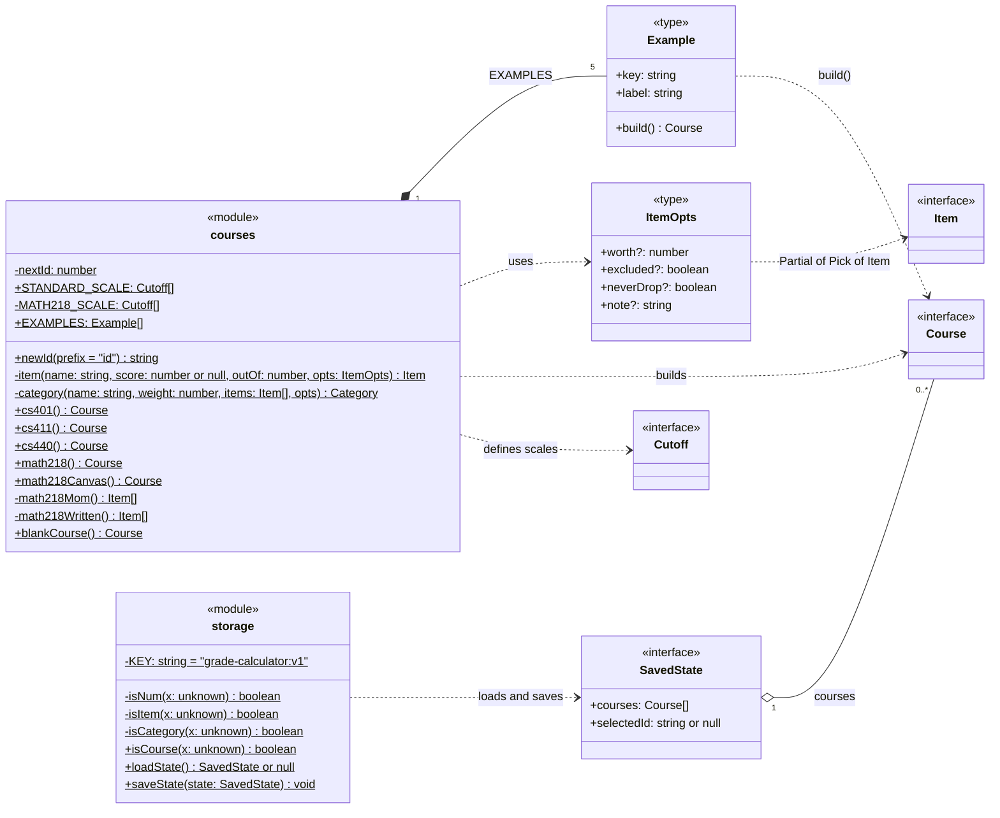
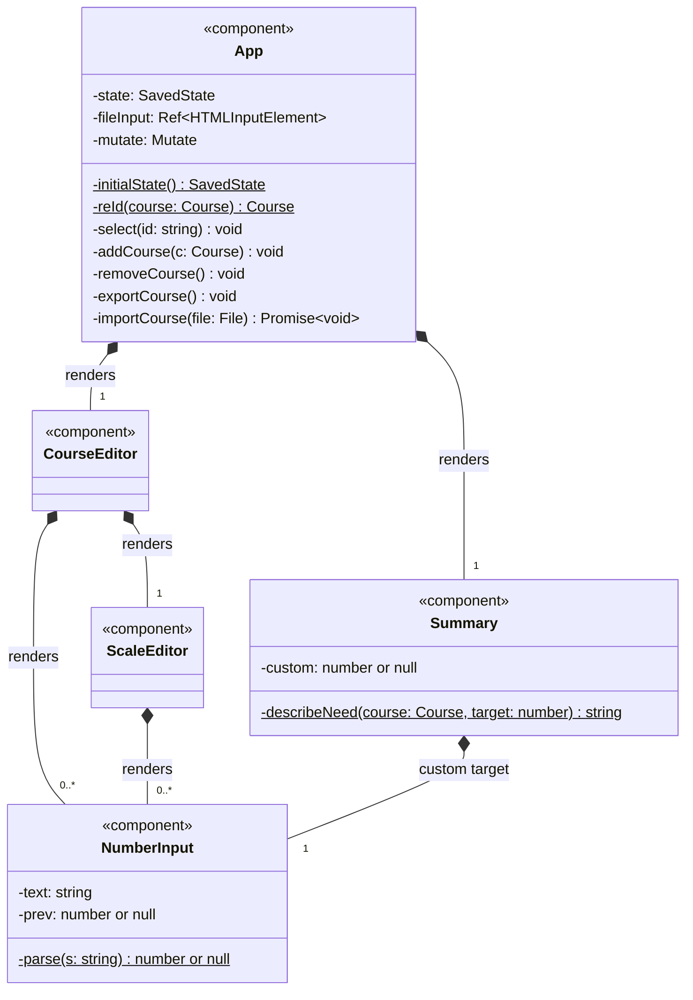
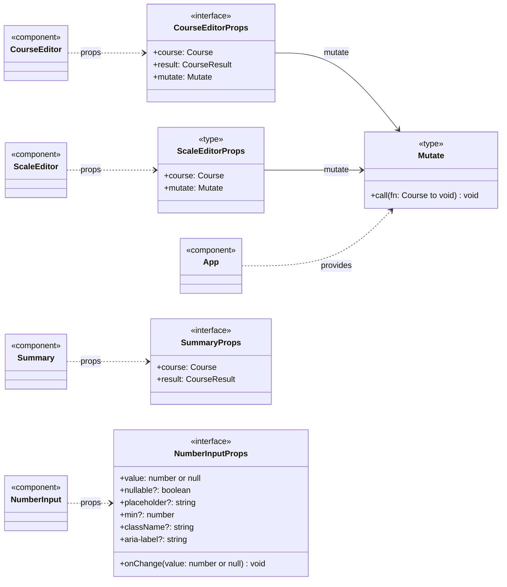

# UML diagrams

These class diagrams cover every type, interface, union and module in `src/`. The code is functional TypeScript and has no `class` declarations, so the diagrams use these conventions:

| Notation | Meaning in the code |
|---|---|
| `«interface»` | a TypeScript `interface` |
| `«enumeration»` | a string-literal union used as an enum (`Scheme`) |
| `«union»` / `«variant»` | a discriminated union and its members, told apart by `kind` |
| `«type»` | a `type` alias |
| `«module»` | a source file; its top-level functions and constants appear as static (underlined) members |
| `«component»` | a React function component; its `useState` values appear as attributes |
| `+` / `-` | exported / module-private |
| `?` | optional property |

## 1. Module overview

## 2. Domain model (`src/grade/types.ts`)

A `Course` owns its categories and letter scale, and each `Category` owns its items.

## 3. Results (`types.ts` and `engine.ts`)

The engine returns a result tree that mirrors the course tree. Each result node points back to the input node it was computed from. `NeededResult` is the discriminated union that `neededOnRemaining` returns.

## 4. Grading engine (`src/grade/engine.ts`)

`Candidate` is module-private. `chooseKept` works on candidates for the Canvas-exact drop-lowest/highest search. `EarnedPossible` stands for the inline return type `{ earned: number; possible: number }`.

## 5. Course data and storage (`src/grade/courses.ts`, `src/storage.ts`)

`ItemOpts` is `Partial<Pick<Item, 'worth' | 'excluded' | 'neverDrop' | 'note'>>`. `Example` is the inline element type of `EXAMPLES`. The `is*` guards are TypeScript type predicates (`x is Course`, and so on).

## 6. UI components (`src/App.tsx`, `src/components/`)

### 6a. Component tree

`App` keeps the `SavedState` in `useState`. `initialState`, `reId`, `describeNeed` and `parse` are module-level helpers in their component's file, so they are drawn as static members.

### 6b. Props and the `Mutate` callback

In the source, all three props interfaces are module-private and named `Props`. They are renamed here to tell them apart. `ScaleEditor` (private to `CourseEditor.tsx`) takes an inline props type. `Mutate` is `(fn: (draft: Course) => void) => void`: App clones the selected course, lets `fn` edit the draft, and stores the result.
