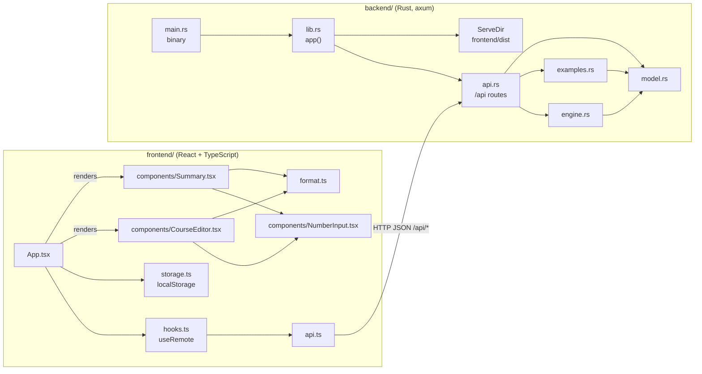
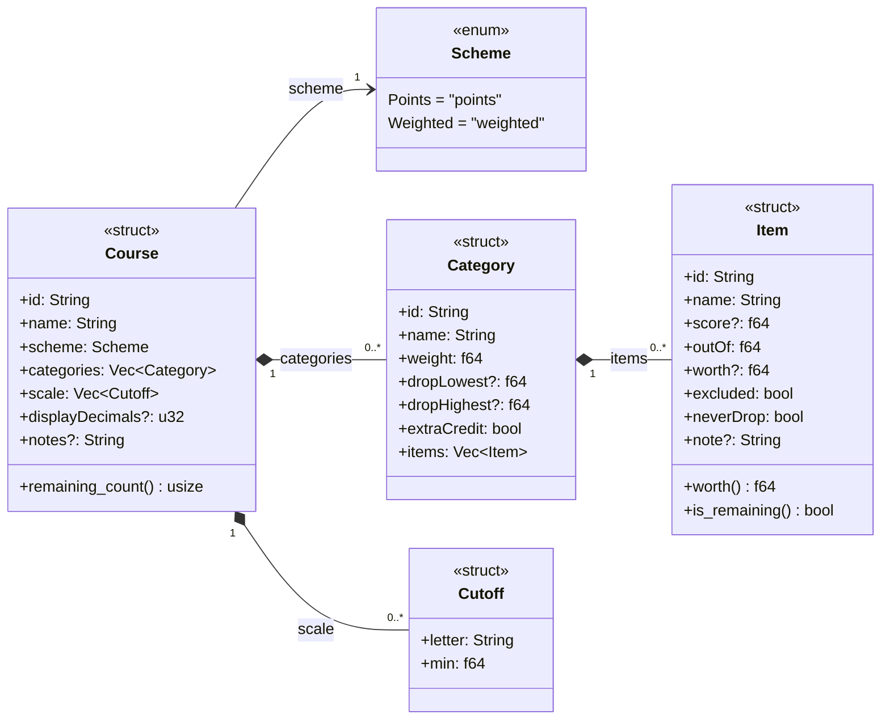
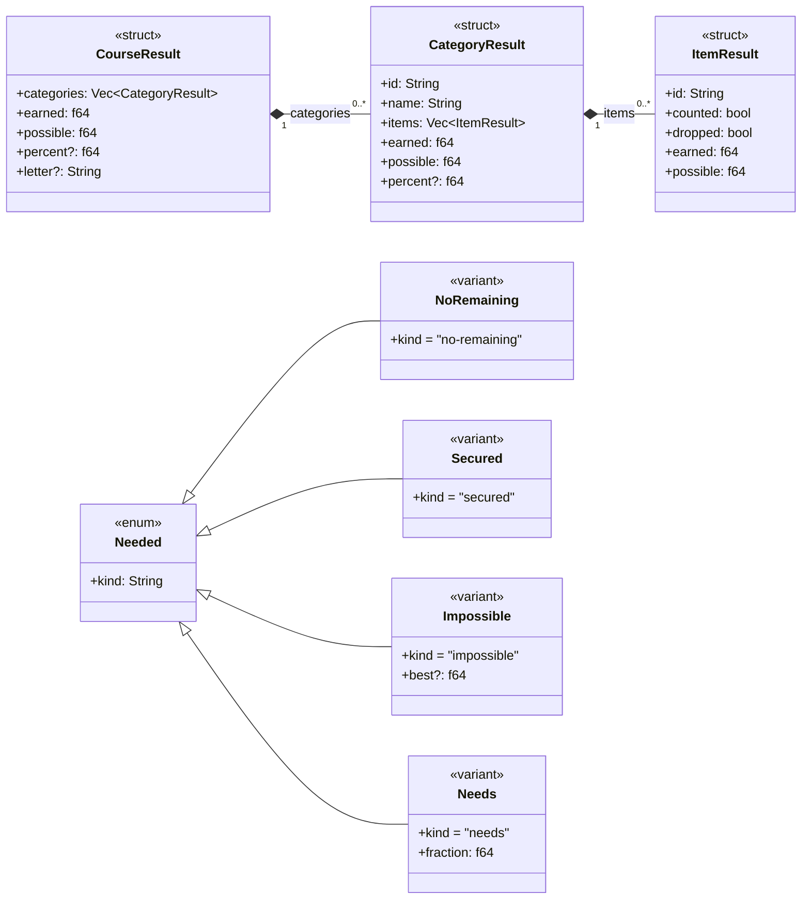
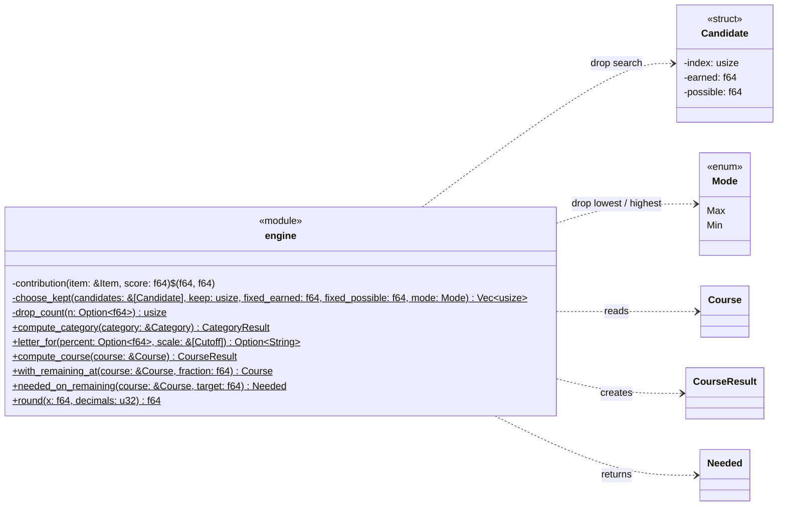
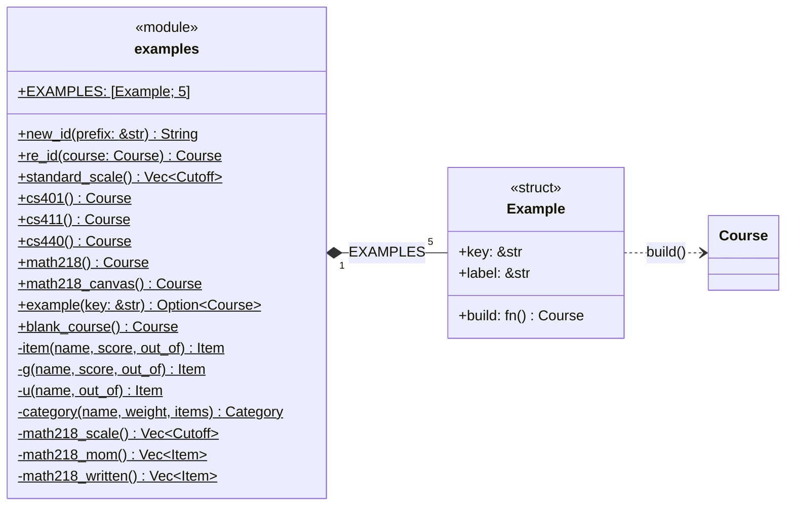
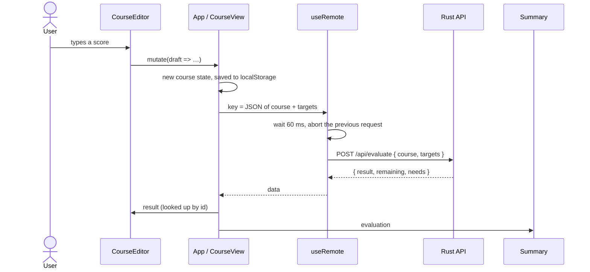
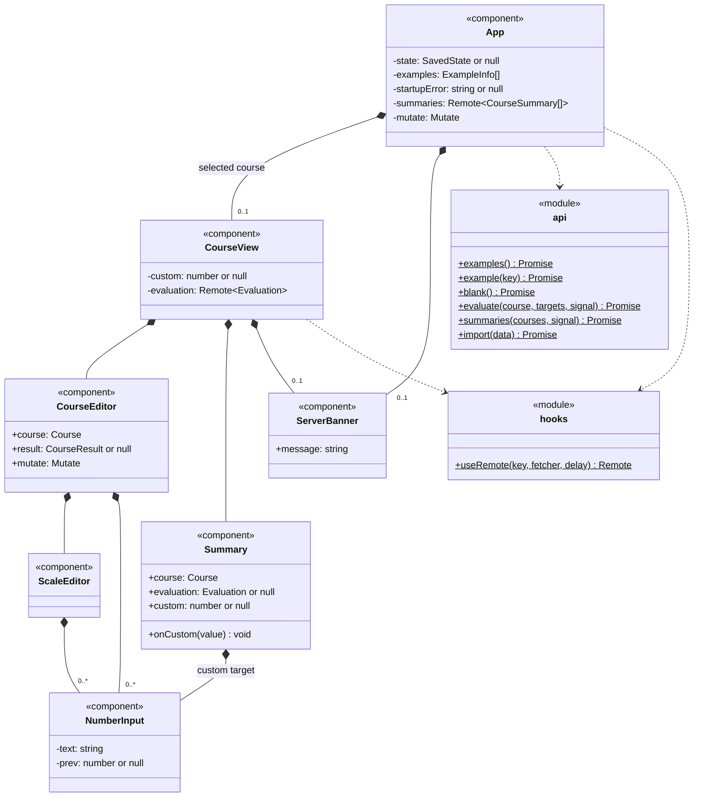

# UML diagrams

These diagrams cover the Rust server in `backend/src/` and the React front-end in `frontend/src/`. Neither side uses classes in the object-oriented sense, so the diagrams use these conventions:

| Notation | Meaning in the code |
|---|---|
| `«struct»` / `«enum»` | a Rust `struct` / `enum` (field names shown as they appear in JSON, camelCase) |
| `«variant»` | one variant of a Rust enum that serialises with a `kind` tag |
| `«interface»` / `«type»` | a TypeScript `interface` / `type` alias |
| `«module»` | a source file; its free functions and constants appear as static (underlined) members |
| `«component»` | a React function component; its `useState` values appear as attributes |
| `+` / `-` | public (`pub` / `export`) / private |
| `?` | optional (`Option<T>` in Rust, `?` in TypeScript) |

## 1. Architecture

The browser keeps the courses; the server does every calculation and holds no user data.

## 2. Domain model (`backend/src/model.rs`, mirrored in `frontend/src/types.ts`)

A `Course` owns its categories and letter scale, and each `Category` owns its items.

`excluded`, `neverDrop` and `extraCredit` default to `false` and are left out of the JSON when false, so the JSON matches what the TypeScript-only version of the app exported.

## 3. Results (`backend/src/model.rs`)

The engine returns a result tree that mirrors the course tree. Each result node carries the `id` of the input node it was computed from; the front-end looks results up by id, so a result that is one keystroke behind never lands on the wrong row. `Needed` is what the "what do I need?" solver returns.

## 4. Grading engine (`backend/src/engine.rs`)

`Candidate` and `Mode` are private. `choose_kept` runs the Canvas-exact parametric search for drop-lowest (`Max`) and drop-highest (`Min`). `needed_on_remaining` bisects on the score given to every remaining item, recomputing the course each step.

## 5. Example courses (`backend/src/examples.rs`)

`g` builds a graded item and `u` an ungraded one; private builder methods (`with_worth`, `exclude`, `with_note`, `drop_lowest`) fill in the optional fields. Server ids contain `-s<n>` and front-end ids contain `-c<n>`, so the two never collide.

## 6. HTTP API (`backend/src/api.rs`)

Each private handler serves the route of the same name in the README's API table. `lib.rs` mounts `api::router()` under `/api`, serves the built front-end for every other path (falling back to `index.html`), and adds CORS, gzip and request logging. Grading runs on `spawn_blocking` threads.

### Editing a score

## 7. Front-end (`frontend/src/`)

`CourseView` is keyed by course id, so switching courses starts with a fresh evaluation. `Mutate` is `(fn: (draft: Course) => void) => void`: `App` clones the selected course, lets `fn` edit the draft, and stores the result. `useRemote` keeps the last good response while a newer one is in flight, so numbers don't flicker while typing.
