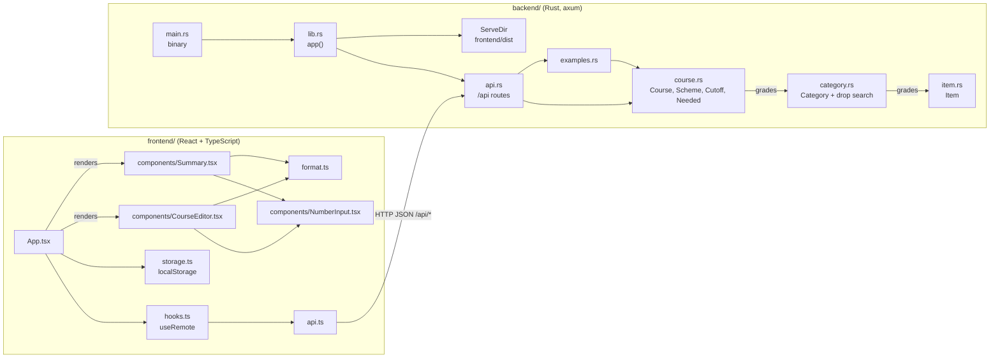
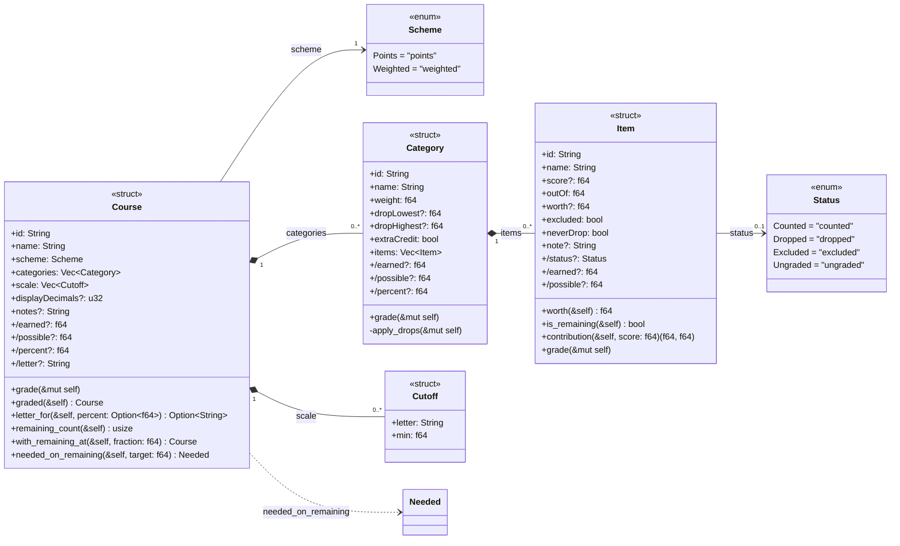
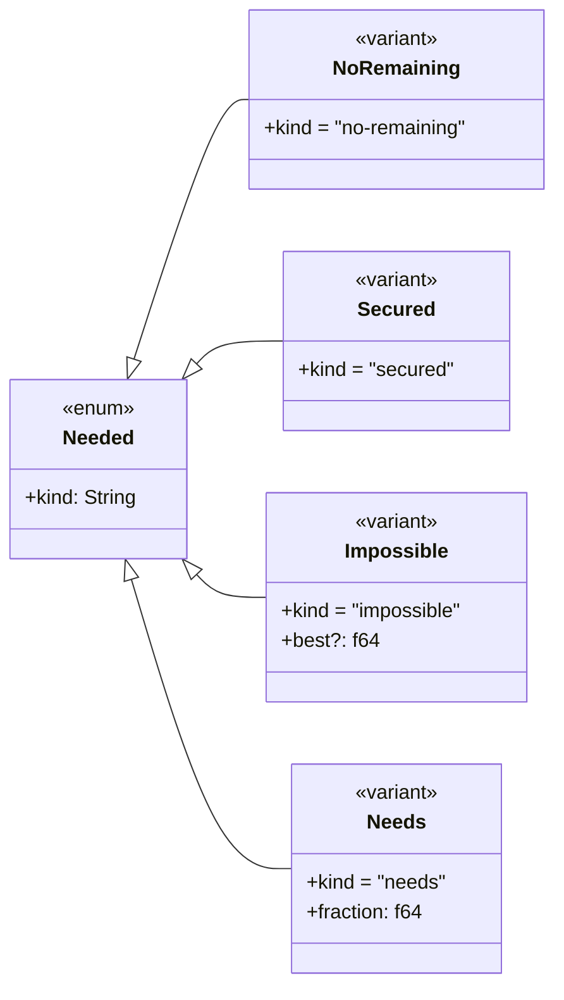
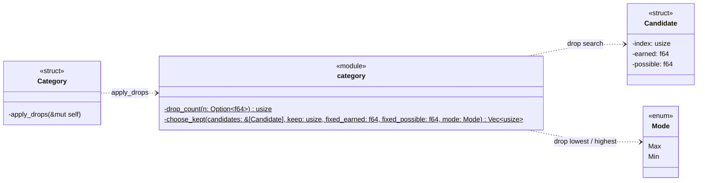
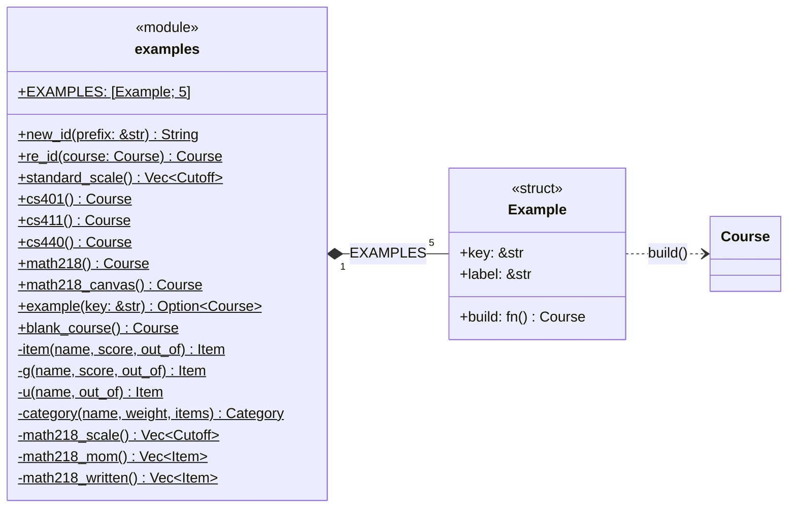
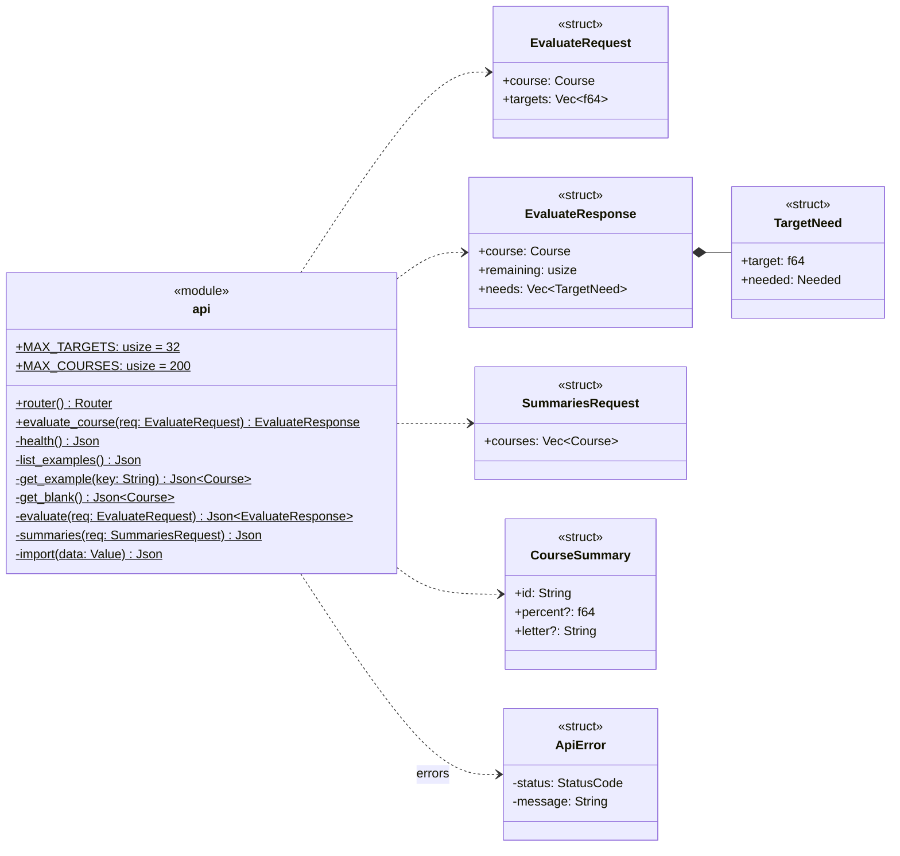
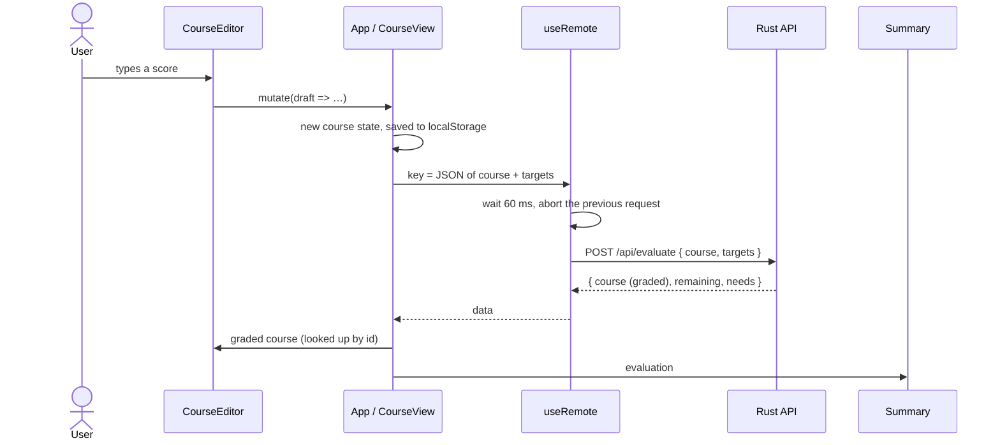
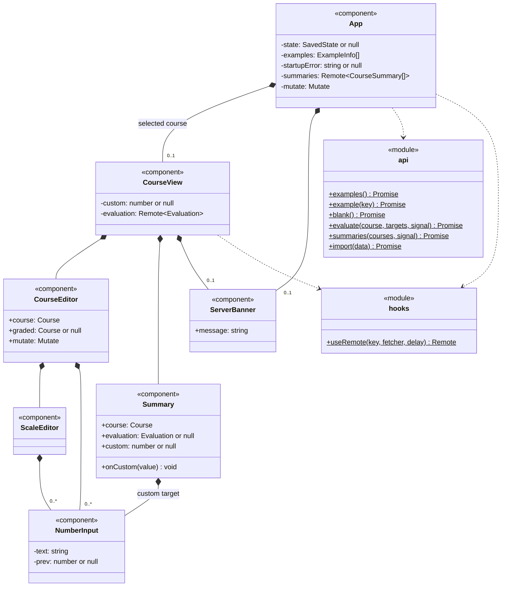

# UML diagrams

These diagrams cover the Rust server in `backend/src/` and the React front-end in `frontend/src/`. Neither side uses classes in the object-oriented sense, so the diagrams use these conventions:

| Notation | Meaning in the code |
|---|---|
| `«struct»` / `«enum»` | a Rust `struct` / `enum` (field names shown as they appear in JSON, camelCase) |
| `«variant»` | one variant of a Rust enum that serialises with a `kind` tag |
| `«interface»` / `«type»` | a TypeScript `interface` / `type` alias |
| `«module»` | a source file; its free functions and constants appear as static (underlined) members |
| `«component»` | a React function component; its `useState` values appear as attributes |
| `+` / `-` | public (`pub` / `export`) / private |
| `?` | optional (`Option<T>` in Rust, `?` in TypeScript) |
| `/` before a name | computed by `grade()`, not entered by the user (`Option<T>`, omitted from the JSON until the course is graded) |

## 1. Architecture

The browser keeps the courses; the server does every calculation and holds no user data.

## 2. Domain model and grading (`backend/src/item.rs`, `category.rs`, `course.rs`; mirrored in `frontend/src/types.ts`)

A `Course` owns its categories and letter scale, and each `Category` owns its items. Each type lives in its own module together with the logic that grades it, and the grade lives on the same types: the fields marked `/` are filled in by `grade()`. `Course::grade` grades each category, and `Category::grade` grades each item and then applies its drop rules.

- `excluded`, `neverDrop` and `extraCredit` default to `false` and are left out of the JSON when false, so the JSON matches what the TypeScript-only version of the app exported.
- The computed fields are `None` and left out of the JSON until the course is graded, so the courses the browser stores and exports never contain them. They are also ignored when a course is deserialised: a client can't send in a grade, it is always recomputed.
- On a graded course, a category's or the course's `percent` (and the course's `letter`) stays absent when nothing is graded yet; `earned` and `possible` are always present.
- Every node keeps its `id`, so the front-end matches graded values to rows by id. An evaluation that is one keystroke behind never lands on the wrong row.
- `Item::grade` sets each item's `Status` to `Excluded` (if marked excluded, even once it has a score), `Ungraded` (no score) or `Counted`; `Category::apply_drops` then changes some `Counted` items to `Dropped`. The category sums only `Counted` items, and the front-end styles each row by its status. A dropped item keeps its `earned` and `possible`.
- `Course::needed_on_remaining` bisects on the score given to every remaining item (via `with_remaining_at`), regrading a copy of the course each step.
- `round` (display rounding, used by tests) and the serde helper `is_false` are free functions in `lib.rs`, which also re-exports all six types at the crate root.

## 3. "What do I need?" (`backend/src/course.rs`)

`Needed` is what `Course::needed_on_remaining` returns for one target percentage.

## 4. Drop search (`backend/src/category.rs`, private)

`Category::apply_drops` collects the graded, droppable items as `Candidate`s and calls `choose_kept`, which runs the Canvas-exact parametric search for drop-lowest (`Max`) and drop-highest (`Min`). Items marked `neverDrop` are held fixed, and at least one item always stays.

## 5. Example courses (`backend/src/examples.rs`)

`g` builds a graded item and `u` an ungraded one; private builder methods (`with_worth`, `exclude`, `with_note`, `drop_lowest`) fill in the optional fields. Server ids contain `-s<n>` and front-end ids contain `-c<n>`, so the two never collide.

## 6. HTTP API (`backend/src/api.rs`)

Each private handler serves the route of the same name in the README's API table. `lib.rs` mounts `api::router()` under `/api`, serves the built front-end for every other path (falling back to `index.html`), and adds CORS, gzip and request logging. Grading runs on `spawn_blocking` threads.

### Editing a score

## 7. Front-end (`frontend/src/`)

`CourseView` is keyed by course id, so switching courses starts with a fresh evaluation. `Mutate` is `(fn: (draft: Course) => void) => void`: `App` clones the selected course, lets `fn` edit the draft, and stores the result. `useRemote` keeps the last good response while a newer one is in flight, so numbers don't flicker while typing.
