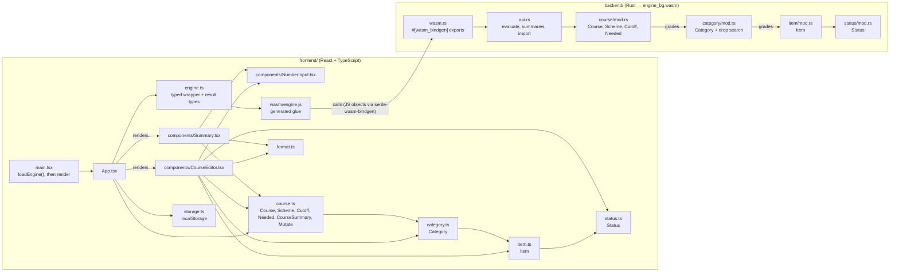
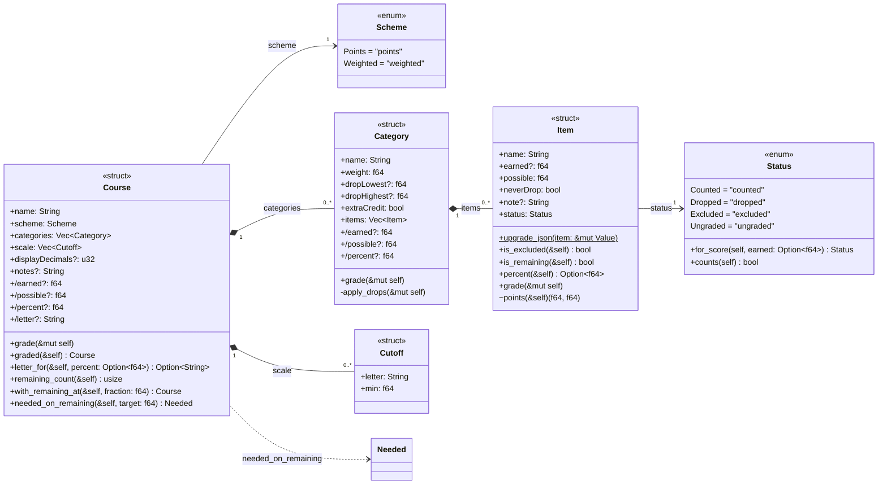
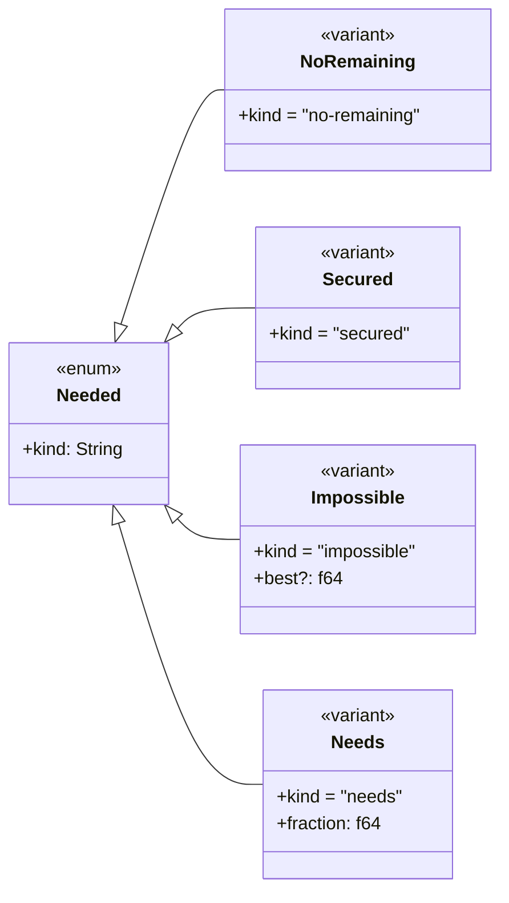
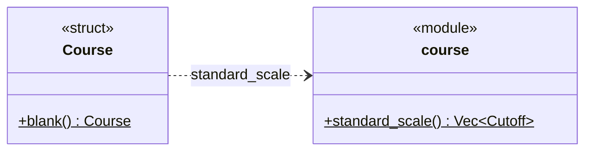
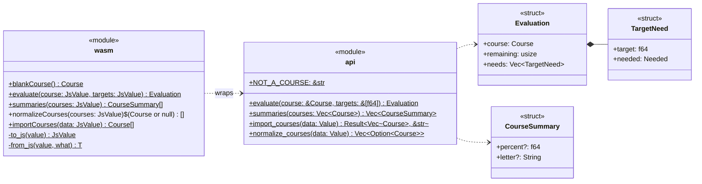
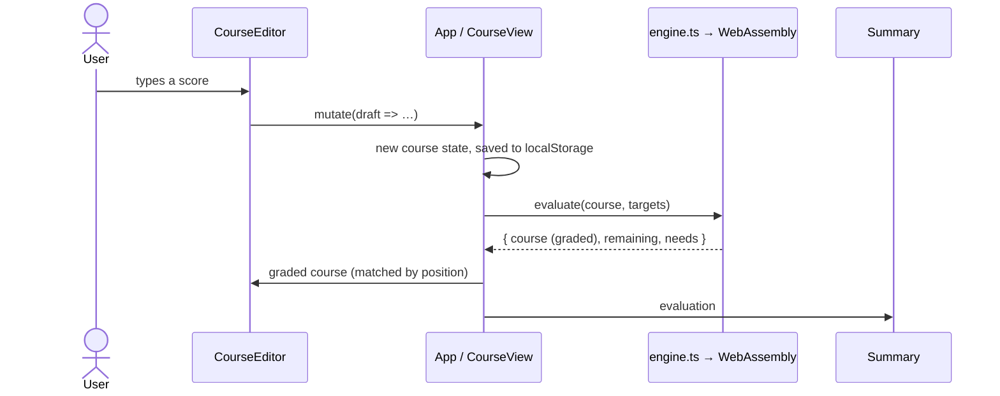
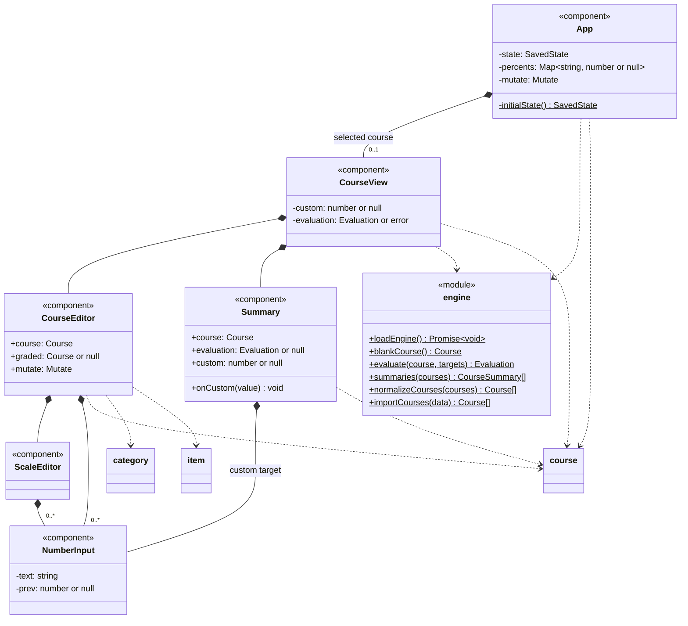
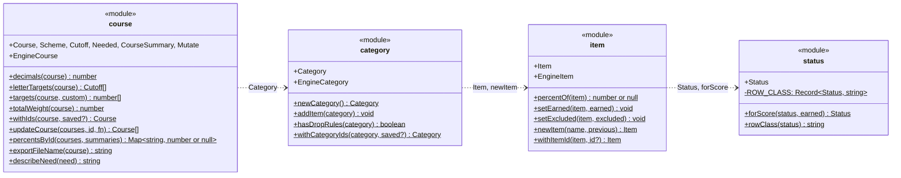

# UML diagrams

These diagrams cover the Rust engine in `backend/src/` (compiled to WebAssembly) and the React front-end in `frontend/src/`. Neither side uses classes in the object-oriented sense, so the diagrams use these conventions:

| Notation | Meaning in the code |
|---|---|
| `«struct»` / `«enum»` | a Rust `struct` / `enum` (field names shown as they appear in JSON, camelCase) |
| `«variant»` | one variant of a Rust enum that serialises with a `kind` tag |
| `«interface»` / `«type»` | a TypeScript `interface` / `type` alias |
| `«module»` | a source file; its free functions and constants appear as static (underlined) members |
| `«component»` | a React function component; its `useState` values appear as attributes |
| `+` / `-` | public (`pub` / `export`) / private |
| `?` | optional (`Option<T>` in Rust, `?` in TypeScript) |
| `/` before a name | computed by `grade()`, not entered by the user (`Option<T>`, omitted from the JSON until the course is graded) |

## 1. Architecture

Everything runs in the browser. The Rust engine is compiled to a WebAssembly module that the React app loads once at startup and then calls synchronously; courses are kept in localStorage. There is no server: the built app is static files on GitHub Pages.

## 2. Domain model and grading (`backend/src/item/mod.rs`, `category/mod.rs`, `course/mod.rs`; mirrored in `frontend/src/item.ts`, `category.ts`, `course.ts`)

A `Course` owns its categories and letter scale, and each `Category` owns its items. Each type lives in its own module together with the logic that grades it, and the grade lives on the same types: the fields marked `/` are filled in by `grade()`. `Course::grade` grades each category, and `Category::grade` grades each item and then applies its drop rules.

- `neverDrop` and `extraCredit` default to `false` and are left out of the JSON when false.
- The computed fields are `None` and left out of the JSON until the course is graded, so the courses the browser stores and exports never contain them. They are also ignored when a course is deserialised: a client can't send in a grade, it is always recomputed.
- On a graded course, a category's or the course's `percent` (and the course's `letter`) stays absent when nothing is graded yet; `earned` and `possible` are always present.
- The engine has no ids: they belong to the front-end (React keys, the selected course, which course an edit applies to), and serde ignores any it is given. A graded course keeps its categories and items in the same order, so the front-end matches results to rows by position.
- An item is `earned` out of `possible` points; those points are also how much it counts in its category. `Item` uses serde's derived `Deserialize`. Courses that come in from outside (import, saved courses) first go through `course::upgrade_json`, which walks to each category's and item's `upgrade_json` and rewrites the older `score` / `outOf` / `worth` / `excluded` JSON into the current form, converting points exactly as the old engine scored them (`score / outOf × worth` out of `worth`). `api::parse_courses` then grades each item's status, so only an `"excluded"` status is taken from the input.
- `Status` lives in its own module (`status/`) and is a stored field of every item. Only `Excluded` is the user's choice and is kept as given; `Status::for_score` turns anything else into `Counted` (has a score) or `Ungraded` (no score), and `Category::apply_drops` then changes some `Counted` items to `Dropped`. So a status sent in from outside is never trusted except for `Excluded`, and older data's `excluded: true` becomes `Excluded`. The category sums only `Counted` items, and the front-end styles each row by the graded status. A dropped item keeps its `earned` and `possible`, so the UI can still show the score.
- `Course::needed_on_remaining` bisects on the score given to every remaining item (via `with_remaining_at`), regrading a copy of the course each step.
- Each of `item/`, `category/`, `course/`, `status/` and `utils/` keeps its code in `mod.rs` and its unit tests in `tests.rs` (declared as `#[cfg(test)] mod tests;`).
- `round` (display rounding, used by tests) and the serde helper `is_false` live in `utils/` (`mod.rs`, with their tests in `tests.rs`). `lib.rs` only declares the modules (`api`, `category`, `course`, `item`, `utils`, `wasm`); types are used by their full paths, e.g. `crate::course::Course`.

## 3. "What do I need?" (`backend/src/course/mod.rs`)

`Needed` is what `Course::needed_on_remaining` returns for one target percentage.

## 4. Drop search (`backend/src/category/mod.rs`, private)

`Category::apply_drops` collects the graded, droppable items as `Candidate`s and calls `choose_kept`, which runs the Canvas-exact parametric search for drop-lowest (`Max`) and drop-highest (`Min`). Items marked `neverDrop` are held fixed, and at least one item always stays.

## 5. The blank course (`backend/src/course/mod.rs`)

`Course::blank` is the starting point behind the app's **New** button: weighted, a Homework and an Exams category with one ungraded item each, and the standard 90/80/70/60 scale.

The four courses in `docs/` live in `backend/tests/fixtures/mod.rs` as test data only; `tests/courses.rs` checks that the engine reproduces every total in their gradebook PDFs.

## 6. Engine interface (`backend/src/api.rs`, `backend/src/wasm.rs`)

`api.rs` holds the operations the front-end needs as plain Rust, so they are tested natively. `wasm.rs` exports them to JavaScript with `#[wasm_bindgen]`, converting arguments and results with `serde-wasm-bindgen` and turning errors into thrown JS `Error`s.

All `wasm` functions return `Result<JsValue, JsError>`; the types shown are what the JavaScript side receives.

### Editing a score

Grading happens synchronously during the render, in a few milliseconds even for courses with drop rules.

## 7. Front-end (`frontend/src/`)

The model and its front-end logic mirror the Rust modules: one file per type, holding the interface and the functions that work on it. All grading happens in the engine; these helpers only build, edit and display courses.

`main.tsx` awaits `loadEngine()` (which fetches and instantiates the `.wasm`) before rendering `App`, so every `engine` call after that is synchronous. `CourseView` is keyed by course id and grades its course with `useMemo` whenever the course or the custom target changes; if the engine throws (for example on a malformed course from storage), it shows an error banner instead. `Mutate` (in `course.ts`) is `(fn: (draft: Course) => void) => void`: `App` passes `fn` to `updateCourse`, which clones the selected course, lets `fn` edit the draft, and returns the new course list. `engine.ts` gives every course the engine returns its ids with `withIds` (new ids, or the saved ones matched by position in `normalizeCourses`), and also holds the engine's other result type (`Evaluation`), mirroring `api.rs`; `CourseSummary` and `percentsById`, which turns summaries into each course's percentage for the course picker, are in `course.ts`.
